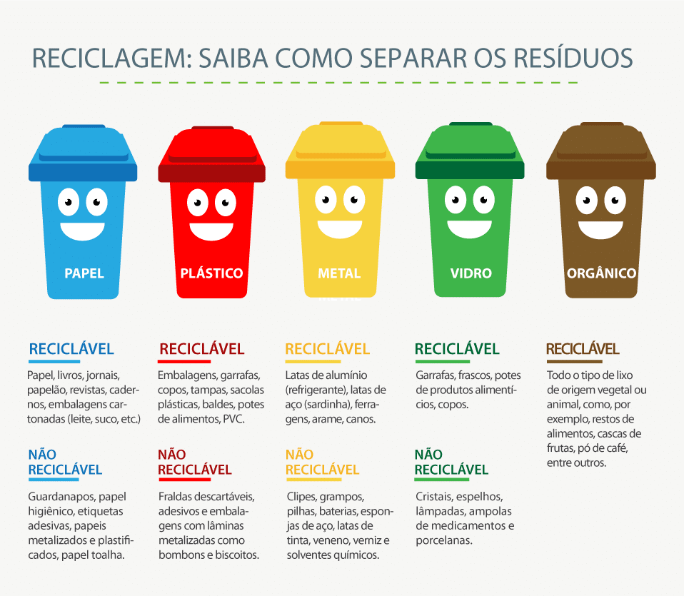

 
 ### [ SLIDE 1 ]
 # O que é coleta seletiva?

Uma maneira de identificar, separa e redirecionar as espécies dos materiais dispensados, de forma que possa promover um ambiente mais saudável com a sociedade.

Mesmo que isoladamente possa parecer simples ou insignificante, um pequena semente também pode germinar em uma grande árvore com o passar o tempo, e produzir frutos; Ou seja, os rendimentos apresentados podem ser o retorno econômico (através da reciclagem), um lugar mais bonito, e uma vila mais orgnaizada para viver com mais dignidade!

 

 ## As Cores Comuns Encontradas

 -  Acompanha a imagem a seguir [ AZUL, VERMELHO, AMARELO, VERDE E MARROM ]: 

    

 ### [ SLIDE 2 ]
 # Vídeo Explicativo

<video src="./recic-virtual-sipat.mp4" controls width="600"></video>
